<picture><source media="(prefers-color-scheme: dark)" srcset="assets/hero-dark.svg"></picture>

<picture><source media="(prefers-color-scheme: dark)" srcset="assets/about-dark.svg"></picture>

<picture><source media="(prefers-color-scheme: dark)" srcset="assets/stack-dark.svg"></picture>

<a href="https://github.com/Duxgfun/novata"><picture><source media="(prefers-color-scheme: dark)" srcset="assets/project-novata-dark.svg"></picture></a>&nbsp;<a href="https://github.com/Duxgfun/paperfly.site"><picture><source media="(prefers-color-scheme: dark)" srcset="assets/project-paperfly-site-dark.svg"></picture></a>

<a href="https://github.com/Duxgfun/TpVFX"><picture><source media="(prefers-color-scheme: dark)" srcset="assets/project-tpvfx-dark.svg"></picture></a>

<picture><source media="(prefers-color-scheme: dark)" srcset="assets/stats-dark.svg"></picture>

<picture><source media="(prefers-color-scheme: dark)" srcset="assets/streak-dark.svg"></picture>

<picture><source media="(prefers-color-scheme: dark)" srcset="assets/wave-dark.svg"></picture>

<a href="https://duxgg.fun"><picture><source media="(prefers-color-scheme: dark)" srcset="assets/button-1-dark.svg"></picture></a>&nbsp;&nbsp;<a href="https://github.com/Duxgfun?tab=repositories"><picture><source media="(prefers-color-scheme: dark)" srcset="assets/button-2-dark.svg"></picture></a>

<a href="https://gwdvzz.github.io/expressive-profile/?from=Duxgfun"><picture><source media="(prefers-color-scheme: dark)" srcset="assets/credit-dark.svg"></picture></a>

